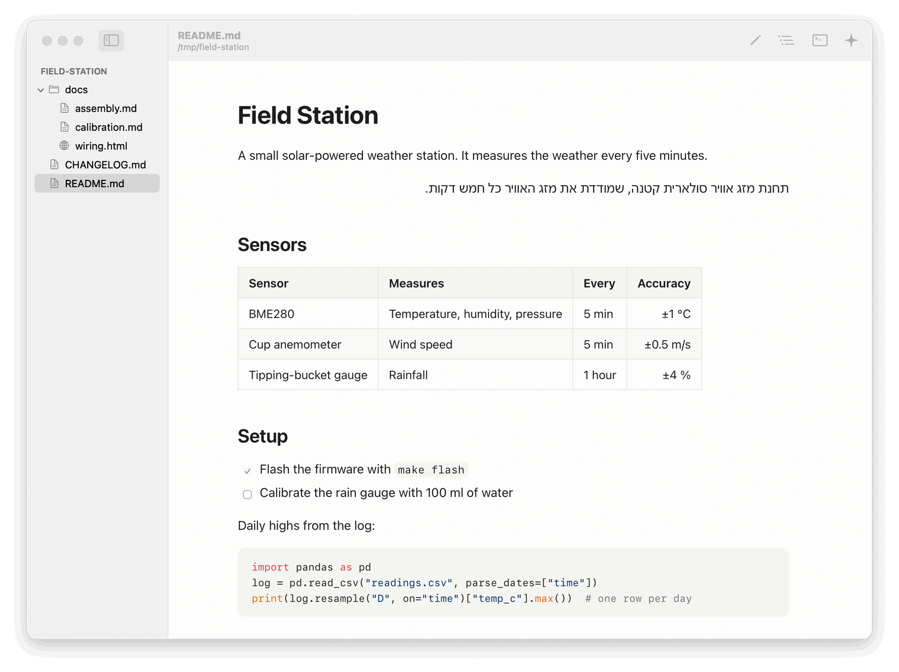
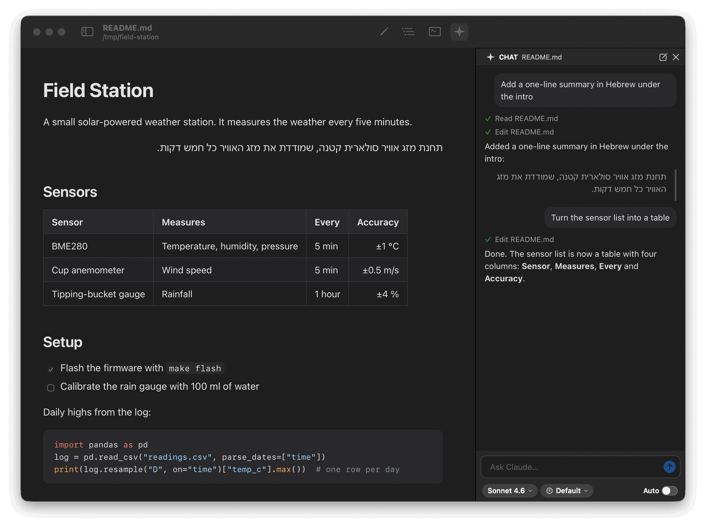

# MD Viewer

A calm macOS app for reading and lightly editing markdown, viewing HTML, and
asking Claude to change the document in a chat beside it (or running Claude
Code in a terminal). Native (Swift + AppKit), about 8 MB, starts in half a
second, and free and open source all the way down.





## Install

MD Viewer runs on macOS 14 or later, on Apple Silicon and Intel Macs. Download
the app, or build it yourself.

### Download the app

1. Download the `.zip` file from the
   [latest release](https://github.com/nissanida/md-viewer/releases/latest),
   and open it to unzip.
2. Drag **MD Viewer** into your **Applications** folder.
3. Open it. The first time, macOS blocks it, because the app isn't notarized
   by Apple (see [Notarization](#notarization-later)). Close the warning, open
   **System Settings → Privacy & Security**, scroll down, click **Open
   Anyway** next to MD Viewer, and confirm. You do this once per Mac.

On macOS 14, right-clicking the app and choosing **Open** also works (macOS 15
removed that shortcut). Or, in Terminal:
`xattr -dr com.apple.quarantine "/Applications/MD Viewer.app"`.

### Build it yourself

An app you build on your own Mac opens without that warning. You need the
Xcode Command Line Tools (`xcode-select --install`). Then:

```bash
git clone https://github.com/nissanida/md-viewer.git
cd md-viewer
make install
```

This builds the app for Apple Silicon and Intel, copies it to
`/Applications/MD Viewer.app` and registers it with Finder. Run `make install`
again after any change to rebuild and reinstall. To drag the app into
Applications yourself instead, run `make app && make reveal`.

Optional command-line helper (`mdviewer README.md`, `mdviewer docs/`, or just
`mdviewer` for the current folder):

```bash
make install-cli
```

`make uninstall` removes both.

### Make it the default for markdown (or HTML)

In the app, open the **MD Viewer** menu and choose **Make Default for Markdown
Files** (or **Make Default for HTML Files**). Once it is the default, the item
shows a checkmark. From the second launch on, the app also offers this once, in
a slim banner above a markdown document.

The Finder way works too: select a `.md` file, press ⌘I (Get Info), choose
**MD Viewer** under **Open with**, and click **Change All…**. Use the same steps
with another app to switch back. As HTML default, MD Viewer opens local HTML
files (with scripts off until trusted); web links still open in your browser.

## Using it

Open a file from Finder, the Dock icon, ⌘O, or by dropping it on the window.
Open a folder (⇧⌘O, or drop it) to browse its markdown and HTML files in the
sidebar; its README opens automatically. Everything else stays hidden until
you ask for it.

| Action | Shortcut |
| --- | --- |
| Open file / folder | ⌘O / ⇧⌘O |
| Preview / Source / Edit with live preview | ⌘1 / ⌘2 / ⌘3 |
| Toggle source view | ⌘/ |
| Save | ⌘S |
| Find, next, previous | ⌘F, ⌘G, ⇧⌘G |
| Sidebar / Outline / Terminal / Chat | ⌃⌘S / ⌃⌘O / ⌃` / ⌃⌘C |
| Start Claude Code | ⌃⇧` |
| Send file path / selection to the terminal | ⌥⌘P / ⌥⌘J |
| Zoom in / out / actual size | ⌘= / ⌘- / ⌘0 |
| Reload from disk | ⌘R |
| Print / Export as PDF | ⌘P / File menu |

- **Live reload.** When a file changes on disk (for example, Claude Code edits
  it), the preview updates and keeps your place. If you have unsaved edits,
  the app asks before replacing them.
- **Links.** Links to other markdown or HTML files open in the app, web links
  in your browser. Links to other local files open only if they are plain
  documents (images, PDFs, text); anything that could run, such as apps or
  scripts, is shown in Finder instead.
- **Right-to-left text.** Hebrew and Arabic paragraphs, lists and tables read
  right to left automatically.
- **Your place is remembered:** the last folder and file, window size, view
  mode and which panels are open.

### Chat with Claude

The chat panel (⌃⌘C, or the Claude button in the toolbar) is the easy way to
change a document: write what you want ("make the intro shorter", "fix the
typos", "turn this list into a table") and watch the document change. It runs
your own Claude Code underneath, with your account, settings, skills and
CLAUDE.md, in the same folder the terminal uses.

- Claude gets the open document and any text you selected, so you never type
  file names.
- Edits to the open document happen right away. **Undo** puts the file back as
  it was before Claude's last change. Anything else, such as other files or
  commands, asks **Allow** or **Deny** first.
- Replies are formatted, with Hebrew and Arabic reading right to left. Each
  step Claude takes shows as one short line.
- **Return** sends and **Shift+Return** starts a new line. **Stop** ends a
  request, and **New Chat** (in the panel's header) starts over.
- Unsaved edits are saved before a message is sent, so Claude works on what
  you see.
- Under the message box, choose the model (named for the model behind it,
  such as Sonnet 4.6 for Claude Code's default), how much effort Claude puts
  in, and **Auto** mode. Off (the default): Claude asks before anything
  beyond the open document. On: Claude Code's own checker approves routine
  actions and asks only about risky ones (not every model supports it), and
  Undo becomes a small button in the panel's header instead of a bar. Choices
  are remembered and apply from your next message.
- If Claude Code isn't installed or signed in, the panel says what to do.

### Terminal and Claude Code

The terminal panel (⌃`) runs your own shell as a login shell, so `claude`,
`node` and everything on your PATH are found exactly as in Terminal.app. It
starts in the folder open in the sidebar (usually your project's root, where
`CLAUDE.md` lives). Click **Start Claude Code**, or turn
on **Terminal → Start Claude Code Automatically**. If `claude` isn't
installed, the panel shows how to install it.

- **Shift+Return** inserts a newline in Claude Code; Option works as Meta.
- **⌥⌘P** types `@path/to/file` (Claude Code's file reference) at the prompt;
  **⌥⌘J** pastes the selected text. Neither presses Return for you.
- Closing the window keeps the session running; click the Dock icon to come
  back. Quitting asks first if Claude Code (or anything else) is still running.

### HTML files

HTML opens with its scripts turned off and every request to the internet
blocked. Its own local styles and images still load. A notice tells you what
was blocked and offers two ways to allow it:

- **Trust This File:** scripts and remote content for that file only.
- **Trust Folder…:** every HTML file in the folder open in the sidebar
  (usually your project) and its subfolders, including files added later. You
  confirm first; broad folders such as Downloads or your home folder get an
  extra warning.

Trust is remembered. **Stop Trusting** in the notice, or **View → Trusted
Folders**, takes it back.

## Security model

- Every file is treated as untrusted. Markdown is rendered with markdown-it and
  cleaned with DOMPurify, and a strict content security policy lets only the
  app's own scripts run. Raw HTML in markdown can't run scripts, embed frames
  or submit forms.
- The document web views have no bridge to the app at all; links are handled by
  native code. The terminal is a separate native view. A document therefore
  has no way to run commands or type into the terminal.
- Local images are served only if they are images, audio or video, so a
  document can't pull other files into the page.
- The chat's transcript is a display-only page like the previews: Claude's
  replies are sanitized, can't call the app, and can't load remote images.
  Allow, Deny and Undo are native buttons. Only the open document is edited
  without asking, and that edit can be undone. MD Viewer never sees your
  Claude login; Claude Code handles it.

## Development

```bash
make run FILE=README.md   # run from source, without installing
make test                 # Swift tests + markdown rendering tests (needs Node)
make app ARCHS=arm64      # faster build, Apple Silicon only
make zip                  # the download for a release, built from the committed code
make help                 # every task
```

Build products and caches live in `~/Library/Caches/md_html_reader`, outside
iCloud Drive (iCloud would sync thousands of build files and add metadata that
code signing rejects).

| Path | What it holds |
| --- | --- |
| `Sources/MDViewer/` | The app: window, sidebar, previews, editor, terminal, menus |
| `Sources/MDViewerCore/` | Logic without UI: file watching, folder listing, links, shell lookup |
| `web/` | The preview page: `render.js` (markdown pipeline), `page.js`, `style.css`, `vendor/` libraries; the chat's transcript page: `chat.html`, `chat.js`, `chat-page.js`, `chat.css` |
| `packaging/` | `Info.plist` (file types), app icon, `mdviewer` script |
| `scripts/` | App build, the release zip, icon, vendoring, the automation helper, and a stand-in for `claude` (`fake-claude.py`) |
| `Tests/` | Swift tests (`MDViewerCoreTests`) and rendering tests (`web/`) |

The JavaScript libraries are pinned in `scripts/update-vendor.sh` and committed
as files in `web/vendor/`; `make vendor` re-downloads them after a version bump.

**Automation for testing.** Launched with `MDV_AUTOMATION=1`, the app accepts
commands from `scripts/automate.swift` (window snapshots, menu actions, reading
the terminal), so changes can be checked without clicking. Normal launches
never enable it.

```bash
swiftc scripts/automate.swift -o /tmp/automate
open --env MDV_AUTOMATION=1 -a "/Applications/MD Viewer.app" README.md
/tmp/automate "snapshot /tmp/window.png"
```

The chat can be driven the same way (`chat-send`, `chat-type`, `chat-stop`,
`chat-new`, `chat-state <file.json>`). With automation on, `MDV_CLAUDE_PATH`
swaps `claude` for `scripts/fake-claude.py`, which answers without an account
(it can edit the document, ask for approval, write slowly or act signed out),
and `MDV_CLAUDE_MODEL` picks a cheaper model for live tests. Keep the stand-in
outside iCloud Drive when testing, or macOS asks for folder access first.

## Notarization (later)

To share the app without the first-launch warning, it must be signed with a
Developer ID and notarized by Apple. This needs a paid Apple Developer account
(USD 99 a year); the tools are already in the Command Line Tools.

1. Create a **Developer ID Application** certificate in your Apple Developer
   account and install it in Keychain.
2. Sign with the hardened runtime instead of the ad-hoc signature in
   `scripts/build-app.sh`:
   `codesign --force --deep --options runtime --timestamp --sign "Developer ID Application: Your Name (TEAMID)" "MD Viewer.app"`
3. Zip and notarize: `ditto -c -k --keepParent "MD Viewer.app" app.zip`, then
   `xcrun notarytool submit app.zip --apple-id you@example.com --team-id TEAMID --wait`.
4. Attach the ticket: `xcrun stapler staple "MD Viewer.app"`.

## Credits

[SwiftTerm](https://github.com/migueldeicaza/SwiftTerm) (MIT),
[markdown-it](https://github.com/markdown-it/markdown-it) and its footnote
plugin (MIT), [DOMPurify](https://github.com/cure53/DOMPurify) (Apache-2.0 or
MPL-2.0), [highlight.js](https://highlightjs.org) (BSD-3-Clause). Licenses are
in `web/vendor/licenses/`.
